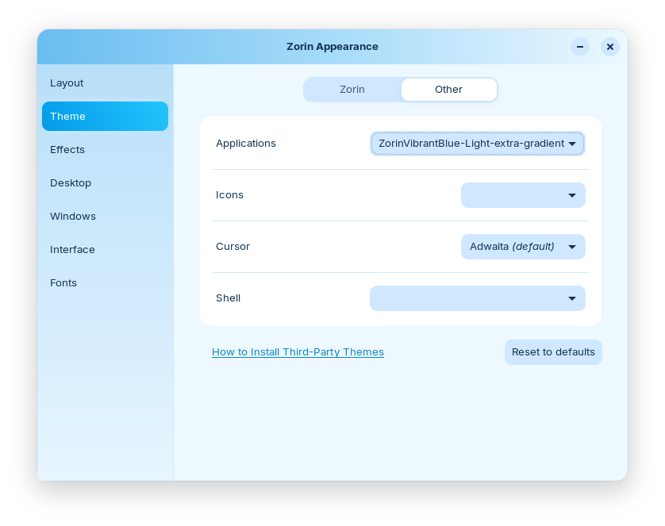
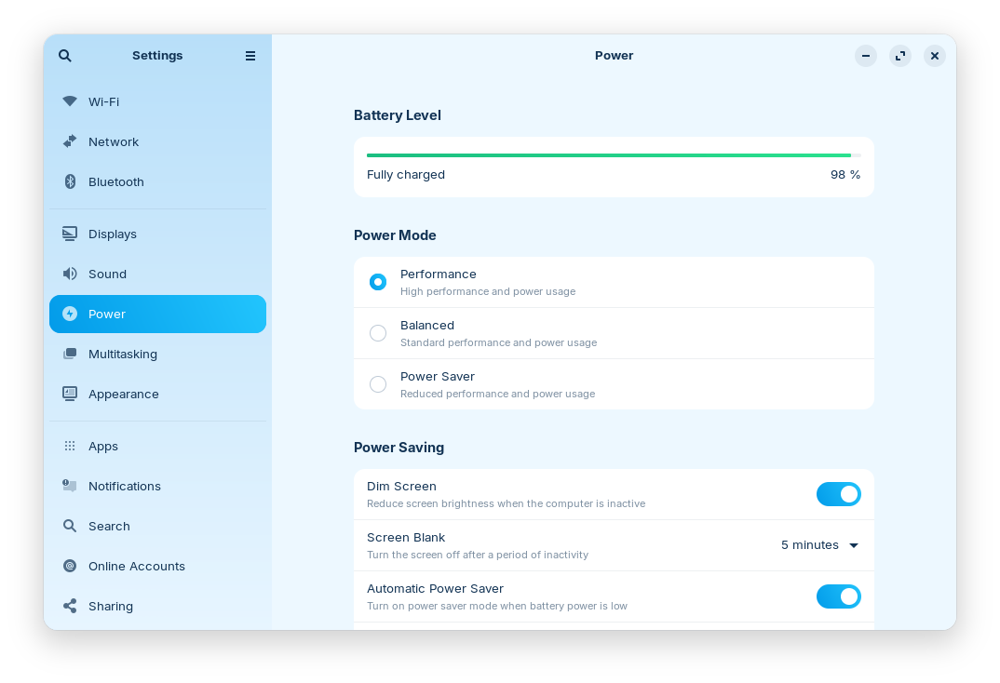
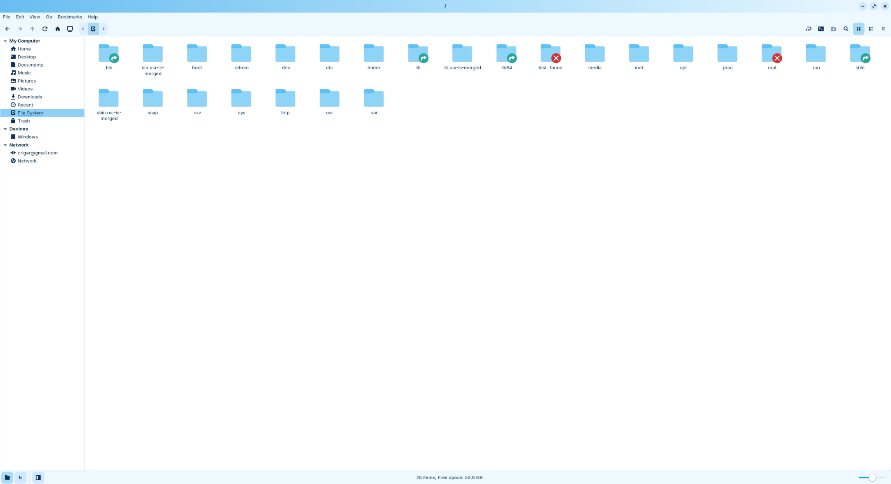

# Zorin Vibrant Themes

☕🍺 **Like this project?**  
If you enjoy this solution, consider [buying me a coffee or a beer](https://buymeacoffee.com/criger).  
I get thirsty from time to time, and your support helps fund my ***very serious research*** into which beverage tastes best when I'm thirsty 😄

<a href="https://buymeacoffee.com/criger">
  
</a>

---

**More color for Zorin OS — without replacing what makes Zorin work.**

Zorin Vibrant Themes is an unofficial, community-maintained set of colorful GTK3/GTK4 application themes based on Zorin's original light themes. It preserves Zorin's rounded corners, widgets, spacing, layout, icons, and system accent colors while giving the background surfaces and optional gradients more character.

> **Unofficial community project** by **Cristhian Gertner**. Not affiliated with or endorsed by Zorin OS.

## Screenshots

These are **original, unmodified PNG screenshots** captured on Zorin OS 18.1 with the historical `ZorinVibrantBlue-Light-extra-gradient` theme. The new **Gradient** style includes these extended sidebar rules. Actual appearance may vary by GTK version and application.

<table>
  <tr>
    <th>Zorin Appearance</th>
    <th>GNOME Settings</th>
  </tr>
  <tr>
    <td><a href="docs/images/zorin-appearance-extra-gradient.png"></a></td>
    <td><a href="docs/images/gnome-settings-extra-gradient.png"></a></td>
  </tr>
</table>

**Nemo file manager — full-width gradient titlebar**

[](docs/images/nemo-gradient-titlebar.png)

*Screenshots show a previously published prototype, not a mockup. The six other color families still need independent visual verification across applications.*

## Choose your color, intensity, and style

Eight color families are available: **Blue, Green, Yellow, Orange, Red, Purple, Brown, and Grey**.

Each color has four optional variants:

| Intensity | Vibrant (solid colors) | Gradient (complete gradient style) |
| --- | --- | --- |
| Light — softer colors | `ZorinVibrant<Color>-Light` | `ZorinVibrant<Color>-Light-Gradient` |
| Rich — stronger colors | `ZorinVibrant<Color>` | `ZorinVibrant<Color>-Gradient` |

The `<Color>` placeholder is replaced with the color name, for example `Green` or `Purple`. This makes **32 possible themes**, but the theme manager installs **only the variants you select**. There is no need to clutter Zorin Appearance with all 32 entries.

**Important:** Both Light and Rich are **light-based GTK themes**. Rich is not Zorin Dark mode. Every variant uses its corresponding original `/usr/share/themes/Zorin<Color>-Light` source and retains the system's accent colors and widget geometry.

The **Gradient** variant combines the earlier Gradient titlebar/sidebar effect with the *Extra-Gradient* fixes for additional GTK3/GTK4 navigation panels. There is no separate Extra-Gradient choice in the new installer. Gradient does **not** mean blur or translucent glass.

## Install and uninstall: one interactive manager

**Requirements:** Zorin OS with the original color themes under `/usr/share/themes/`, Python 3 (standard library only), and a desktop session for selecting the theme. Tested locally on Zorin OS 18.1; other releases remain unverified.

```bash
cd ~
git clone https://github.com/criger/zorin-vibrant-themes.git
cd zorin-vibrant-themes
python3 install.py
```

If you have already cloned the project, update your checkout before running `python3 install.py`.

The manager behaves as follows:

- **No Vibrant themes installed:** goes directly to color selection.
- **At least one Vibrant theme installed:** offers **Install**, **Uninstall**, **Show installed themes**, or **Exit**.
- **Install:** choose color, intensity (Light/Rich/Both), then style (Vibrant/Gradient/Both); confirm the exact variants to install.
- **Uninstall:** choose one installed theme or all listed themes; confirm removal.
- **Already installed variant:** refuse accidental replacement; explicitly approve an overwrite to create a timestamped backup.
- **Active theme being uninstalled:** switch to Zorin's original `ZorinBlue-Light` before deleting it.

Confirmation prompts use `[y/N]` (Enter means **no**). No `sudo` and no changes to `/usr/share/themes`.

After installation, choose the theme under **Zorin Appearance → Theme → Other → Applications**. Use the default light color scheme, for example:

```bash
gsettings set org.gnome.desktop.interface color-scheme 'default'
gsettings set org.gnome.desktop.interface gtk-theme 'ZorinVibrantGreen-Light-Gradient'
```

To return to an original Zorin GTK theme:

```bash
gsettings set org.gnome.desktop.interface gtk-theme 'ZorinBlue-Light'
```

Reopen affected applications when changing themes; some GTK4/libadwaita apps may apply their own styles.

### Optional command-line mode

```bash
# Install one Light Blue Gradient variant
python3 install.py --install blue --tone light --variant gradient

# Install Rich Purple without gradients
python3 install.py --install purple --tone rich --variant vibrant

# Install all four Green variants, and no other colors
python3 install.py --install green --tone both --variant both

# List installed themes
python3 install.py --list

# Uninstall a particular theme (asks for confirmation)
python3 install.py --uninstall ZorinVibrantBlue-Light-Gradient

# Inspect every supported option
python3 install.py --help
```

The CLI defaults to `--tone rich --variant gradient` when omitted. The interactive manager remains the recommended way to install and uninstall themes.

## Existing installations and retired variants

The new manager uses names shared with some of the previous Blue themes. For example, `ZorinVibrantBlue-Gradient` now includes the **extra sidebar coverage** as well as its original gradients. If you have the older version with the same name, reinstalling it through the new manager (and approving replacement) gives you the updated version while retaining a backup.

The older `scripts/install.py`, `scripts/install_gradients.py`, and `scripts/install_extra_gradients.py` remain in the repository for historical reproducibility; **use the new root-level `python3 install.py` for new installations**. The historical scripts are not required by the new manager.

To preview and optionally remove only retired **Blue/Green Extra-Gradient and Glass** folders:

```bash
python3 cleanup_legacy.py --dry-run
python3 cleanup_legacy.py
```

The new cleanup script recognizes **only** `-extra-gradient` and `-Glass` names for Blue/Green; it does **not** remove current Light, Rich, or Gradient variants. Do not use older experimental cleanup scripts on a new installation.

## What the installer changes

- Reads the original `Zorin<Color>-Light` GTK theme from the local machine; copies it to a separate, user-specific folder under `~/.themes/`.
- Recolors only light `gtk-3.0/gtk.css` and `gtk-4.0/gtk.css` using color-specific palettes.
- For Gradient, adds narrowly targeted titlebar and navigation/sidebar gradients, including the previously approved Extra-Gradient selectors.
- Keeps the original theme's icons, widget geometry, dark stylesheets, Shell styling, panel, taskbar, wallpaper and fisheye extension unchanged.
- Updates the generated theme's metadata, preserves the GTK4 `.libadwaita` marker, and adds derivative-change and GPL notices.
- Uses preflight checks and staging; explicit replacements are backed up under `~/.themes/.zorin-vibrant-backups/` and rolled back on an installation failure.

**Safety note:** A former experimental broad `.background` / `window.background` gradient caused a white-wallpaper regression when all windows were minimized. The new generator does **not** reintroduce those global overrides. No glass transparency or compositor blur is included.

## Development and testing

```bash
python3 -m unittest discover -s tests -v
python3 -m compileall -q install.py cleanup_legacy.py scripts tests
```

The theme-manager test module checks all 32 variant combinations, source compatibility, selective installation, backup/rollback, safe removal, and English prompts with synthetic Zorin-style file trees. Previous installers have their own historical test modules. These automated tests do not establish visual compatibility across all Zorin releases or third-party applications.

The Blue palettes and initial Green palette were visually reviewed on Zorin OS 18.1. Other colors were generated from their stock Zorin counterparts and remain subject to real desktop testing. All 8 colors were inspected against their original Zorin color files.

## Credits, copyright, and licensing

- **Original upstream theme:** [Zorin Desktop Themes](https://github.com/ZorinOS/zorin-desktop-themes) — © its original authors, distributed under GNU GPL version 2.
- **Zorin Vibrant Themes:** palette design, generator, installers, documentation and maintenance by **Cristhian Gertner**, © 2026 where applicable.
- **License:** [GNU GPL v2](LICENSE) (`GPL-2.0-only`). Generated derivatives preserve upstream attribution.

The repository does **not** vendor Zorin's original CSS. Installed copies are made from the user's own Zorin installation. This project does not claim authorship of Zorin's original assets.

## Related work

[ZorinOS Fisheye Taskbar](https://github.com/criger/zorinos-fisheye-taskbar) enhances the existing Zorin taskbar while preserving its layout. It is independent of this theme project.

Issues and contributions are welcome. Include your Zorin version, GTK application/version, and screenshots with private details removed.
